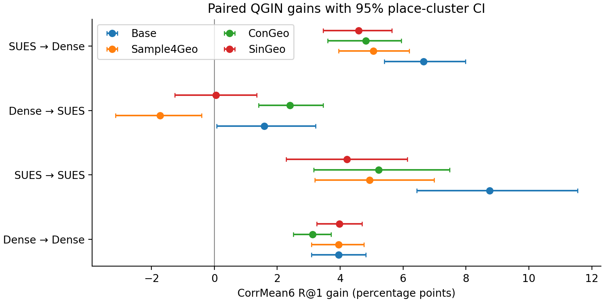

# QGIN: Quantile-Guided Intensity Network

QGIN is a training-time pointwise photometric augmentation for cross-view geo-localization. It anchors random nonlinear activation hinges to spatial quantiles while keeping pixel locations fixed. **ConGeo-QView** applies QGIN to the secondary query of a four-view ConGeo objective. The retrieval encoder and its 768-dimensional inference descriptor remain unchanged.

The release contains portable operator/host code, pinned baseline contracts, seven-condition evaluation, place-cluster statistics, and complete paper tables. All runs use the shared EVA-family ViT-B/16 identifier `vit_base_patch16_rope_reg1_gap_256.sbb_in1k`, 384 × 384 input, 108 common warmup updates, 648 formal updates and seeds 42/43.

## ConGeo-QView results

CorrMean6 R@1, two-seed means. Gains use paired 2,000-draw place-cluster 95% confidence intervals.

| Train → test | ConGeo† | ConGeo-QView | Gain (pp) [95% CI] |
| --- | --- | --- | --- |
| Dense → Dense | 82.61 | 85.73 | 3.12 [2.51, 3.71] |
| SUES → SUES | 87.24 | 92.46 | 5.22 [3.16, 7.48] |
| Dense → SUES | 71.08 | 73.49 | 2.41 [1.40, 3.46] |
| SUES → Dense | 17.52 | 22.33 | 4.81 [3.60, 5.95] |




## Paper assets

- [Motivation and diagnosis](paper_assets/01_Motivation_and_Diagnosis.md)
- [Method equations and implementation](paper_assets/02_Method_Formulation.md)
- [Complete main benchmark tables](paper_assets/03_Main_Benchmark_Tables.md)
- [Paired host comparisons](paper_assets/04_PlugAndPlay_Host_Tables.md)
- [CTE trajectories, spatial errors, ablations and cost](paper_assets/05_CTE_Spatial_and_Ablation.md)
- [Evidence paths and SHA256 manifest](paper_assets/FILE_MANIFEST.md)

## Code and execution

```text
src/modules/       QGIN, fixed-zero-hinge and standard photometric operators
src/hosts/         shared encoder, source views, objectives, optimizer and replay training
src/baselines/     pinned official-source adapters and MRGeo implementation
src/evaluation/    seven conditions, full-gallery retrieval, cluster bootstrap and CTE
configs_and_contracts/  exact training/evaluation settings and source pins
paper_assets/      paper documents, aggregate CSVs and scientific figures
```

Install the CUDA 12.1 wheels and dependencies in a Python 3.10 environment:

```bash
pip install torch==2.1.2 torchvision==0.16.2 --index-url https://download.pytorch.org/whl/cu121
pip install -r requirements.txt
python scripts/fetch_official.py --root external
python -m unittest discover -s tests -v
```

The fetch script checks out the exact upstream commits used by the contracts. It can also use a previously fetched pinned tree at `QGIN_OFFICIAL_ROOT`. See [third-party sources](THIRD_PARTY.md).

Training accepts local source-only plans and checkpoint inputs:

```bash
python -m src.hosts.train --config configs_and_contracts/run.example.json
```

Edit the example's paths to your dataset, 108-update warmup model/optimizer, and six block plans. Each plan is JSON with `rows` and `batches`; a row contains `query_path`, `reference_path`, `query_id`, `location_id`, and integer `label`. Each block contains 108 index batches. Augmentation files provide frozen per-row `packed` convolution parameters, `p` quantiles, and optional `std` or `seeds` for the controls. The exact historical artifacts and their checksums are indexed by the manifest. The release does not bundle datasets or weights.

Full-gallery evaluation uses a trained model and a target dataset manifest:

```bash
python -m src.evaluation.retrieve --host ConGeo --train-domain dense --target sues --checkpoint checkpoints/congeo_qview.pth --manifest data/sues_test.json --output outputs/retrieval.csv
python -m src.evaluation.summarize inputs.json outputs/benchmark.csv
python scripts/render_assets.py
```

The evaluation manifest schema is documented in `src/evaluation/retrieve.py`. The summary input is a JSON list of `{direction, method, seed, path}` entries pointing to evaluation CSVs. Source and target choices are independent, enabling both zero-shot directions. Evaluation performs no optimization. The renderer rebuilds the paper tables and figures from the committed aggregate CSVs.

## Measurement conventions

The tables retain seed-specific values, two-seed means, uncertainty, and all positive and negative paired changes. DenseUAV uses official trapezoidal AP; SUES-200 uses standard one-positive AP. SUES-200 spatial endpoints are not applicable because its manifest has no GPS. The SUES-trained ColorJitter control was not evaluated. Available training-memory measurements are reported; unrecorded cells are marked —. Checkpoint SHA256 lists identify the evaluated model files without distributing model binaries.
