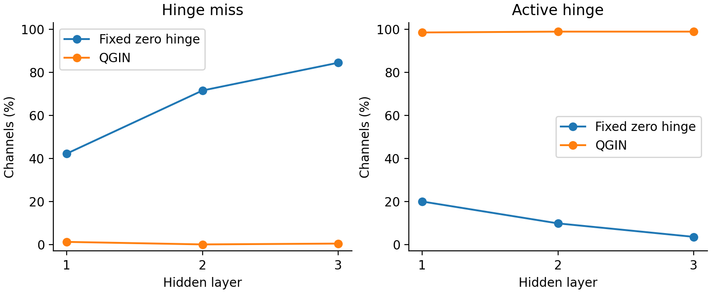

# Photometric robustness and competitor reordering

## Similarity-margin decomposition

For the current best positive score $s_+$, the clean hardest-negative image $n_0$, and the current hardest-negative image $n_*$,

$$m_{\rm all}=s_+-s(n_*)=\underbrace{s_+-s(n_0)}_{m_{\rm old}}-\underbrace{[s(n_*)-s(n_0)]}_{\text{switch penalty}}.$$

The diagnostic uses the frozen encoder after 108 warmup updates and 324 further source updates, two training seeds and 2,331 DenseUAV queries. The native-image Snow transformation shifts both query appearance and the identity of the strongest competitor. MonoHistogramSnow preserves the ordering of HLS lightness while matching the Snow lightness histogram. Image-level and place-level negative switches are listed separately.

Margins and switch penalties are reported ×100 so small changes retain two-decimal readability. Retrieval and switching rates are percentages. Confidence intervals use 2,000 paired resamples of the 777 places.

| Seed | Condition | R@1 % | m_all ×100 | m_old ×100 | Penalty ×100 | Image switch % | Place switch % |
| --- | --- | --- | --- | --- | --- | --- | --- |
| 42 | Clean | 74.35 [71.81, 76.92] | 2.75 [2.45, 3.06] | 2.75 [2.45, 3.06] | 0.00 [0.00, 0.00] | 0.00 [0.00, 0.00] | 0.00 [0.00, 0.00] |
| 42 | Snow | 47.62 [44.96, 50.41] | -0.81 [-1.13, -0.48] | 4.08 [3.75, 4.41] | 4.89 [4.63, 5.14] | 78.89 [77.09, 80.69] | 63.62 [61.30, 65.90] |
| 42 | MonoHistogramSnow | 68.38 [65.85, 71.04] | 2.01 [1.69, 2.32] | 2.93 [2.61, 3.26] | 0.93 [0.85, 1.00] | 43.76 [41.48, 45.90] | 29.69 [27.54, 31.70] |
| 42 | Gamma | 72.93 [70.40, 75.46] | 2.56 [2.25, 2.88] | 2.85 [2.54, 3.17] | 0.29 [0.26, 0.32] | 26.56 [24.67, 28.40] | 17.33 [15.70, 18.92] |
| 43 | Clean | 74.17 [71.68, 76.71] | 2.95 [2.65, 3.27] | 2.95 [2.65, 3.27] | 0.00 [0.00, 0.00] | 0.00 [0.00, 0.00] | 0.00 [0.00, 0.00] |
| 43 | Snow | 52.90 [50.28, 55.64] | -0.22 [-0.53, 0.11] | 4.30 [3.98, 4.62] | 4.52 [4.29, 4.77] | 77.43 [75.50, 79.32] | 63.19 [60.92, 65.51] |
| 43 | MonoHistogramSnow | 70.79 [68.25, 73.32] | 2.32 [2.01, 2.63] | 3.24 [2.92, 3.57] | 0.92 [0.84, 1.01] | 41.87 [39.77, 43.97] | 29.21 [27.20, 31.19] |
| 43 | Gamma | 73.92 [71.34, 76.40] | 2.73 [2.40, 3.06] | 3.05 [2.71, 3.37] | 0.31 [0.28, 0.35] | 26.21 [24.28, 28.01] | 17.20 [15.44, 18.88] |
| mean | Clean | 74.26 [72.05, 76.53] | 2.85 [2.57, 3.16] | 2.85 [2.57, 3.16] | 0.00 [0.00, 0.00] | 0.00 [0.00, 0.00] | 0.00 [0.00, 0.00] |
| mean | Snow | 50.26 [47.98, 52.68] | -0.52 [-0.80, -0.22] | 4.19 [3.91, 4.49] | 4.71 [4.51, 4.91] | 78.16 [76.73, 79.60] | 63.41 [61.54, 65.32] |
| mean | MonoHistogramSnow | 69.58 [67.20, 71.90] | 2.16 [1.87, 2.45] | 3.09 [2.78, 3.38] | 0.92 [0.86, 0.99] | 42.81 [41.18, 44.44] | 29.45 [27.86, 30.97] |
| mean | Gamma | 73.42 [71.11, 75.70] | 2.65 [2.35, 2.95] | 2.95 [2.65, 3.25] | 0.30 [0.28, 0.33] | 26.38 [25.01, 27.69] | 17.27 [16.07, 18.49] |

## First- and second-order photometric controls

P matches Clean per-channel means and standard deviations to its paired Snow image; R restores Snow to the paired Clean image statistics. The photo fraction is (m_Clean − m_P)/(m_Clean − m_Snow), and the feature-oracle recovery fraction is (m_O_Snow − m_Snow)/(m_Clean − m_Snow). O_Snow restores paired Clean shallow-feature means and standard deviations; R restores pixel-level statistics. These controls quantify the portion of the observed margin loss recovered by affine moment matching. The small photo fraction and residual retrieval degradation motivate richer non-affine intensity transformations.

| Seed | Condition | R@1 % | Margin ×100 | Fixed-negative margin ×100 |
| --- | --- | --- | --- | --- |
| 42 | Clean | 74.35 [71.81, 76.92] | 2.75 [2.45, 3.06] | 2.75 [2.45, 3.06] |
| 42 | Snow | 47.62 [44.96, 50.41] | -0.81 [-1.13, -0.48] | 4.08 [3.75, 4.41] |
| 42 | P | 72.11 [69.54, 74.69] | 2.49 [2.19, 2.80] | 2.84 [2.53, 3.15] |
| 42 | R | 48.73 [46.03, 51.52] | -0.66 [-0.98, -0.32] | 4.05 [3.72, 4.38] |
| 42 | O_Snow | 52.81 [50.11, 55.64] | -0.02 [-0.33, 0.30] | 4.24 [3.93, 4.57] |
| 43 | Clean | 74.17 [71.68, 76.71] | 2.95 [2.65, 3.27] | 2.95 [2.65, 3.27] |
| 43 | Snow | 52.90 [50.28, 55.64] | -0.22 [-0.53, 0.11] | 4.30 [3.98, 4.62] |
| 43 | P | 73.10 [70.48, 75.68] | 2.64 [2.32, 2.97] | 3.03 [2.70, 3.36] |
| 43 | R | 55.43 [52.77, 58.13] | -0.04 [-0.35, 0.29] | 4.35 [4.03, 4.68] |
| 43 | O_Snow | 57.61 [54.91, 60.23] | 0.31 [-0.02, 0.63] | 4.37 [4.05, 4.72] |
| mean | Clean | 74.26 [72.05, 76.53] | 2.85 [2.57, 3.16] | 2.85 [2.57, 3.16] |
| mean | Snow | 50.26 [47.98, 52.68] | -0.52 [-0.80, -0.22] | 4.19 [3.91, 4.49] |
| mean | P | 72.61 [70.31, 74.99] | 2.57 [2.27, 2.87] | 2.94 [2.64, 3.24] |
| mean | R | 52.08 [49.74, 54.57] | -0.35 [-0.64, -0.05] | 4.20 [3.92, 4.50] |
| mean | O_Snow | 55.21 [52.87, 57.51] | 0.14 [-0.14, 0.44] | 4.31 [4.03, 4.61] |

| Seed | Photo fraction % | Feature-oracle margin recovery % | Pixel-oracle R@1 gain (pp) |
| --- | --- | --- | --- |
| 42 | 7.29 [5.17, 9.47] | 22.14 [18.75, 25.70] | 1.12 [-0.00, 2.23] |
| 43 | 9.98 [7.12, 12.59] | 16.67 [13.24, 20.06] | 2.53 [1.37, 3.73] |
| mean | 8.64 [6.62, 10.53] | 19.40 [16.47, 22.25] | 1.82 [1.01, 2.66] |

## Quantile anchoring and activation coverage

The source diagnostic fixes 32 source images and four random parameter draws per image, giving 128 image–parameter pairs. Source confidence intervals resample the 32 images as clusters and retain the four parameter draws and channel measurements. This diagnostic uses a fixed seed-42 source plan. It measures augmentation behavior before downstream training.

For positive activation fraction f₊, hinge_miss is f₊ < 0.01 or f₊ > 0.99, and active_hinge is 0.20 ≤ f₊ ≤ 0.80. DC_share is HW times the squared norm of the spatial channel mean divided by output energy plus 10⁻⁶; AC_share is its complement. Energy shares refer to the raw nonlinear output before norm alignment and mixing.

| Operator | Layer | Hinge miss % [CI] | Active hinge % [CI] |
| --- | --- | --- | --- |
| w/o Quantile Anchoring (Fixed Zero-Hinge) | 1 | 42.19 [33.59, 50.39] | 19.92 [13.67, 26.95] |
| w/o Quantile Anchoring (Fixed Zero-Hinge) | 2 | 71.48 [64.45, 78.12] | 9.77 [4.69, 15.62] |
| w/o Quantile Anchoring (Fixed Zero-Hinge) | 3 | 84.38 [79.30, 88.67] | 3.52 [1.56, 5.47] |
| QGIN | 1 | 1.17 [0.00, 3.52] | 98.44 [95.31, 100.00] |
| QGIN | 2 | 0.00 [0.00, 0.00] | 98.83 [96.48, 100.00] |
| QGIN | 3 | 0.39 [0.00, 1.17] | 98.83 [96.48, 100.00] |

The residual E1_delta fits a per-channel affine map; E2_delta fits a full RGB affine map. Fits use 2,048 pixels and are evaluated on 2,048 held-out pixels. Their squared residual is normalized by the centered augmentation-shift energy. The following table reports medians ×100.

| Operator | DC % [CI] | AC % [CI] | E1_delta ×100 [CI] | E2_delta ×100 [CI] |
| --- | --- | --- | --- | --- |
| w/o Quantile Anchoring (Fixed Zero-Hinge) | 99.88 [99.58, 99.97] | 0.12 [0.03, 0.42] | 0.16 [0.04, 0.37] | 0.06 [0.02, 0.15] |
| QGIN | 66.78 [63.12, 75.14] | 33.22 [24.86, 36.88] | 16.47 [12.59, 22.63] | 11.33 [9.01, 17.24] |

The un-clipped subset excludes saturated pixels and retains 127 valid pairs per operator. Its held-out residual medians are listed separately.

| Operator | Unclipped E1_delta ×100 [CI] | Unclipped E2_delta ×100 [CI] |
| --- | --- | --- |
| w/o Quantile Anchoring (Fixed Zero-Hinge) | 0.16 [0.02, 0.31] | 0.04 [0.01, 0.14] |
| QGIN | 14.52 [12.28, 20.14] | 11.88 [9.48, 14.47] |

Unclipped median residual ratios (QGIN / Fixed Zero-Hinge): E1_delta: 90.94×, E2_delta: 322.75×.

These measurements connect spatial quantile anchoring to greater activation coverage, increased alternating spatial energy and stronger nonlinear photometric variation. The downstream operator ablations are in [CTE, spatial and ablation tables](05_CTE_Spatial_and_Ablation.md).
