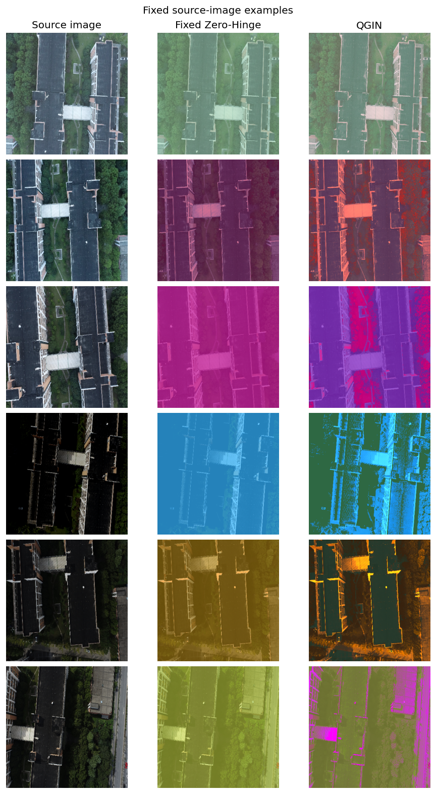

# Motivation and source diagnostics

Under synthetic Snow, the identity of the hardest negative location changes for approximately 63.41% of queries in the earlier two-seed diagnostic. Matching each Clean image's per-channel mean and standard deviation to its paired Snow image accounts for 8.64% of the observed Clean-to-Snow margin loss, using `(margin_clean − margin_matched) / (margin_clean − margin_snow)`. These two figures summarize the earlier diagnostic and are distinct from the three-seed benchmark below.

In the source diagnostic, 32 independent source images each use four fixed parameter draws (128 image–parameter pairs). A hidden-channel hinge is missed if its positive activation fraction is below 1% or above 99%; it is active when that fraction is between 20% and 80%. AC is the spatially varying share of the random network's output energy before alignment and mixing. Affine residuals are held-out squared fitting error divided by centered augmentation-shift energy on unclipped pixels; 127 valid pairs contribute to each median. Larger values indicate more change beyond the respective affine fit. The normalized calculation is in `src/evaluation/source_metrics.py`.

| Variant | Hinge miss % | Active hinge % | Raw AC share % | Channel affine residual (median) | RGB affine residual (median) |
| --- | --- | --- | --- | --- | --- |
| Fixed Zero-Hinge | 66.02 | 11.07 | 2.57 | 0.001678 | 0.000367 |
| MeanHinge | 0.00 | 94.14 | 34.82 | 0.201632 | 0.153041 |
| Q50 | 1.17 | 98.18 | 34.32 | 0.159481 | 0.104546 |
| QuantNoStd | 0.52 | 98.70 | 5.15 | 0.003428 | 0.002884 |
| MeanNoStd | 0.00 | 94.01 | 6.22 | 0.012152 | 0.010305 |
| QGIN | 0.52 | 98.70 | 34.83 | 0.154230 | 0.112843 |

Fixed Zero-Hinge has a 66.02% hinge-miss rate; QGIN has 0.52%. Raw AC share is 2.57% for Fixed Zero-Hinge, 5.15% for QuantNoStd and 34.83% for QGIN. These observations identify activation coverage and output spatial variation as measurable effects of anchoring and scaling.

Six fixed source examples are shown with their two evaluated outputs. [Aggregate data](summary_csv/source128_variant_summary.csv).
