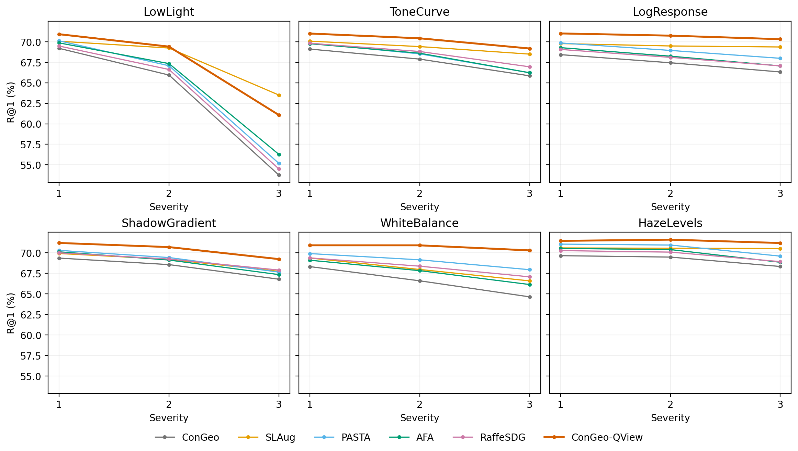

# Ablations and unseen brightness

## Operator ablations

CorrMean6 R@1, percent, mean ± sample standard deviation over three seeds. QGIN here is the Base + QGIN configuration.

| Method | Dense→Dense | SUES→SUES | Dense→SUES | SUES→Dense | 4-direction mean |
| --- | --- | --- | --- | --- | --- |
| Fixed Zero-Hinge | 79.17 ± 1.22 | 86.92 ± 1.14 | 72.77 ± 2.02 | 14.73 ± 1.39 | 63.40 |
| MeanHinge | 82.36 ± 0.48 | 91.35 ± 0.65 | 73.39 ± 0.79 | 18.42 ± 1.08 | 66.38 |
| Q50 | 82.47 ± 0.09 | 91.05 ± 0.77 | 73.31 ± 0.20 | 17.98 ± 0.73 | 66.20 |
| QuantNoStd | 80.85 ± 0.02 | 88.49 ± 0.61 | 73.35 ± 0.73 | 16.29 ± 0.85 | 64.75 |
| MeanNoStd | 81.36 ± 0.72 | 88.54 ± 0.59 | 73.22 ± 1.34 | 16.11 ± 1.02 | 64.81 |
| Base + QGIN | 81.89 ± 0.63 | 90.86 ± 0.36 | 72.30 ± 0.78 | 18.54 ± 1.07 | 65.90 |
| AugMix-Dual | 79.00 ± 0.39 | 86.82 ± 1.03 | 72.84 ± 1.18 | 14.21 ± 0.27 | 63.22 |
| ColorJitter-Dual | 78.07 ± 0.68 | 85.81 ± 1.65 | 71.99 ± 1.99 | 14.70 ± 0.50 | 62.64 |

The MeanHinge and Q50 comparisons against QGIN have intervals crossing zero in all four directions. Their observed differences are small at this sample size; the intervals do not establish equivalence. [Source diagnostics](01_Motivation_and_Diagnosis.md) separate hinge coverage and spatial output energy.

## Eighteen unseen brightness conditions

Six families at three severity levels are applied only to query images, before resize. The following aggregates all 18 conditions equally; 95% intervals use paired seed-by-location resampling.

| Direction | ConGeo | ConGeo-QView | Difference, 95% CI |
| --- | --- | --- | --- |
| Dense→Dense | 85.81 ± 0.89 | 88.14 ± 0.90 | +2.33 [+1.49, +3.21] |
| SUES→SUES | 90.01 ± 0.60 | 94.12 ± 0.19 | +4.11 [+2.01, +6.60] |
| Dense→SUES | 74.73 ± 0.18 | 75.48 ± 0.40 | +0.75 [-0.48, +1.96] |
| SUES→Dense | 17.38 ± 0.50 | 22.62 ± 1.01 | +5.24 [+3.86, +6.77] |

On Dense→SUES, RaffeSDG averages 76.97% and QView 75.48%; RaffeSDG minus QView is +1.50 pp [0.23, 2.84].

Each curve averages the four directions and three seeds equally. The file includes configurations with complete three-seed coverage in a direction. Per-direction, per-seed aggregate values are in [the CSV](summary_csv/unseen_brightness_metrics.csv).
