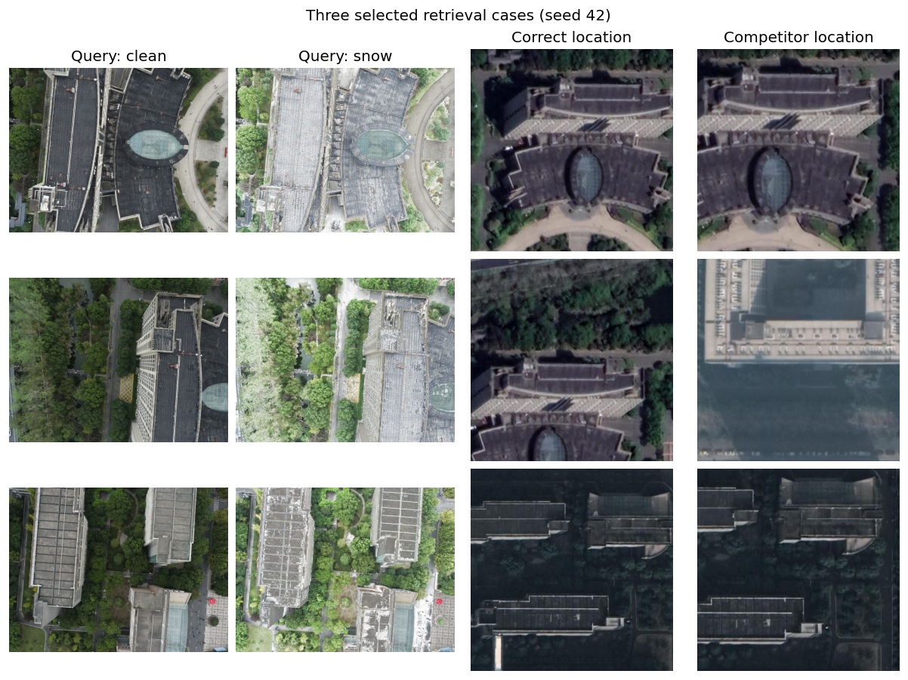

# Competitive takeovers, spatial errors and efficiency

A competitive takeover is defined for a reference model's clean-correct query when the best positive remains above the clean hardest-negative location while a different negative outranks the positive under corruption. Three selected seed-42 examples show the clean and snowy query, the correct location and the competing location.

## New failures under Snow

Reference is ConGeo in the same condition. A new failure is a QView R@1 error on a query where ConGeo is correct; the two denominators are all queries and reference-correct queries, respectively. Mean ± sample standard deviation across seeds 42/43/44:

| Direction | New failures / all queries (%) | New failures / reference-correct queries (%) |
| --- | --- | --- |
| Dense→Dense | 2.73 ± 0.42 | 3.87 ± 0.62 |
| SUES→SUES | 1.91 ± 0.40 | 2.91 ± 0.43 |
| Dense→SUES | 2.44 ± 0.51 | 4.88 ± 0.97 |
| SUES→Dense | 4.60 ± 0.80 | 44.67 ± 5.57 |

## Spatial errors

Dense-target Dis@1 is the distance in metres between the predicted and true location; the far-error rate is the fraction exceeding 200 m. Mean ± sample standard deviation over three seeds:

| Direction | Method | Condition | Dis@1 (m) | >200 m (%) |
| --- | --- | --- | --- | --- |
| Dense→Dense | ConGeo | Snow | 282.96 ± 17.62 | 11.60 ± 0.93 |
| Dense→Dense | ConGeo | CorrMean6 | 94.91 ± 3.22 | 4.11 ± 0.30 |
| Dense→Dense | ConGeo-QView | Snow | 105.94 ± 1.97 | 4.09 ± 0.24 |
| Dense→Dense | ConGeo-QView | CorrMean6 | 48.88 ± 6.78 | 2.05 ± 0.29 |
| SUES→Dense | ConGeo | Snow | 1098.31 ± 106.73 | 50.75 ± 3.72 |
| SUES→Dense | ConGeo | CorrMean6 | 776.67 ± 51.61 | 34.88 ± 2.37 |
| SUES→Dense | ConGeo-QView | Snow | 887.07 ± 71.43 | 39.18 ± 2.38 |
| SUES→Dense | ConGeo-QView | CorrMean6 | 676.03 ± 51.33 | 28.85 ± 2.03 |

SUES has no GPS, so distance metrics are defined for Dense-target evaluation.

## Time and model size

QGIN is applied during training only; retrieval uses the original 768-D encoder and adds no inference parameters. Full-operator CUDA-event timing on a shared RTX 4090 is 12.81 ms median, 35.18 ms p95 over 100 calls. The following median step times include augmentation and optimizer work, exclude data loading, and were measured with seed 44 on a shared GPU:

| Train domain | Method | Median step (s) |
| --- | --- | --- |
| dense | Base (EVA-02 + Label Smoothing) | 2.603 |
| dense | Base + QGIN | 5.809 |
| dense | ConGeo | 4.957 |
| dense | ConGeo-QView | 7.097 |
| sues | Base (EVA-02 + Label Smoothing) | 2.248 |
| sues | Base + QGIN | 5.549 |
| sues | ConGeo | 4.564 |
| sues | ConGeo-QView | 6.333 |

Shared-GPU loading differed across runs. [Per-seed new-failure data](summary_csv/new_failures.csv) and [step timing](summary_csv/training_cost.csv).
